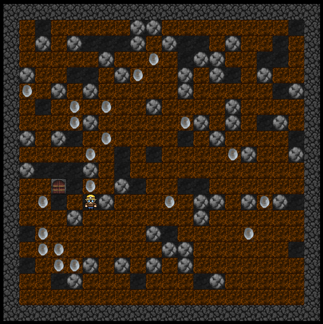

# Stenras!

Välkommen till **Stenras!** – en serie där vi steg för steg bygger ett eget grottspel i [Processing](https://processing.org), inspirerat av klassiska "gräv-och-samla"-spel. Du styr en gruvarbetare som gräver sig genom en grotta, samlar diamanter och försöker undvika fallande stenar.

## Delar

| Del | Innehåll |
|-----|----------|
| [Del 1 – Grottan](del1.md) | Rutnätet, bilder och slumpmässigt genererade grottor |
| [Del 2 – Spelaren](del2.md) | Placera ut och styra vår hjälte med piltangenterna |
| [Del 3 – Menyer och poäng](del3.md) | Spellägen, meny, poängräkning, tidtagning och rullande stenar |

## Vad du behöver

* [Processing](https://processing.org/download) installerat på din dator.
* Spelmallen för den del du ska jobba med – se [Ladda ner kod](nedladdning.md).

!!! tip "Fastnat?"
    Varje del har ett färdigt [lösningsförslag](nedladdning.md#losningsforslag) som zip-fil. Använd det om du vill hoppa in mitt i serien.
